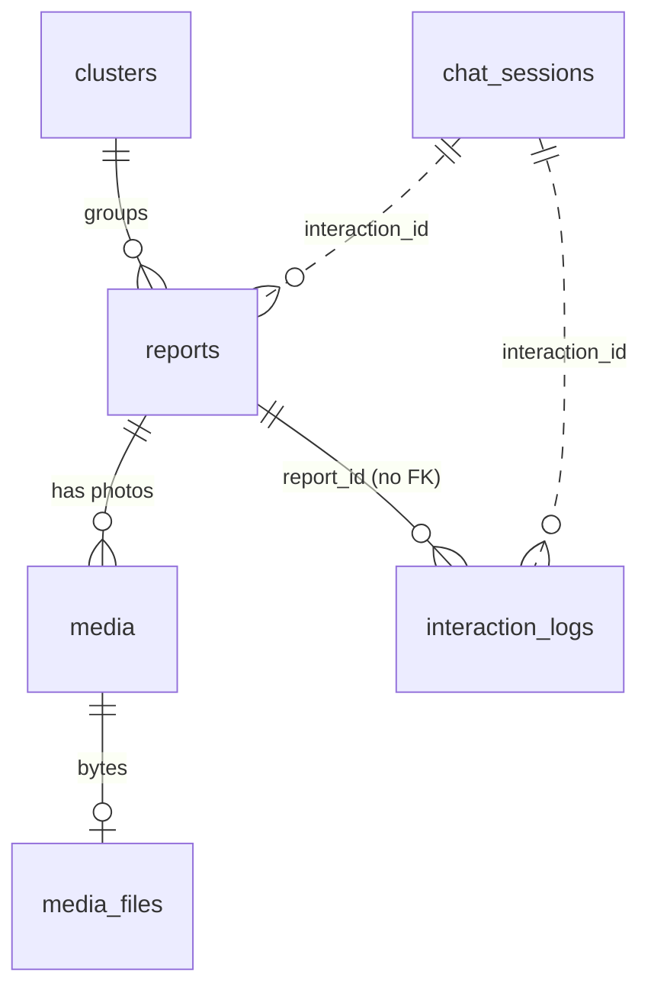

# PI4C database schema

The project stores everything in SQLite (`data/pi4c.db`). Tables are defined in
`app/models.py` and created on startup; there are no migration files.

All timestamps are naive (no time zone) and hold **UTC**.

## Relationships

- `reports.cluster_id` → `clusters.id`
- `media.report_id` → `reports.id`
- `media_files.media_id` → `media.id`, `ON DELETE CASCADE`
- `interaction_logs.report_id` and the `interaction_id` columns are plain indexed columns, not foreign keys.

## Tables

### `reports`: one row per confirmed complaint

Complaint number shown to residents is `PI4C-` + `id` padded to 6 digits (`PI4C-000004`).

| Column | Type | Null | Meaning |
|---|---|---|---|
| `id` | integer, PK | no | Auto-increment |
| `interaction_id` | varchar(36) | no | UUID of the conversation that produced it (indexed) |
| `created_at` | timestamp | no | Indexed |
| `updated_at` | timestamp | no | Set on every change (indexed) |
| `channel` | varchar(16) | no | `telegram` |
| `language` | varchar(8) | no | `te` or `en` |
| `category` | varchar(32) | no | `accessibility`, `civic` or `disaster` (indexed) |
| `subcategory` | varchar(64) | no | Sub-type the resident picked (from `data/taxonomy.json`) |
| `barrier_type` | varchar(64) | no | Classifier's sub-type, or the resident's choice if unsure (indexed) |
| `municipal_subject` | varchar(128) | yes | Municipal subject from the taxonomy |
| `department_id` | varchar(64) | yes | Id from `data/departments.json` (indexed) |
| `severity` | varchar(16) | yes | `low`, `medium`, `high`, `critical` (indexed) |
| `confidence` | double | yes | Classifier confidence, 0 to 1 |
| `classifier` | varchar(16) | yes | `rules` (keyword rules) |
| `classifier_model` | varchar(128) | yes | Empty (no model is used) |
| `summary_en` | text | yes | English summary (empty for now) |
| `needs_review` | boolean | no | True when the classifier was below the confidence threshold (indexed) |
| `pwd_marker` | boolean | no | Reporter is a person with disability or caregiver, or category is accessibility (indexed) |
| `affected` | varchar(16) | no | `self`, `caregiver` or `none` |
| `description_raw` | text | yes | Resident's description as typed |
| `description_type` | varchar(8) | no | Always `text` (voice notes are refused) |
| `description_en` | text | yes | English translation (empty for now) |
| `latitude`, `longitude` | double | no | Shared location |
| `location_name` | varchar(256) | yes | Place name, when a venue was picked on the map or found by place search |
| `location_address` | varchar(512) | yes | Venue address, when given |
| `location_route` | varchar(32) | no | `shared_location` (GPS or map pin) or `place_search` (typed place name, picked from matches) |
| `ward` | varchar(64) | yes | From `data/wards.geojson`, if the point falls in a ward (indexed) |
| `cluster_id` | integer, FK | yes | → `clusters.id` (indexed) |
| `cluster_match` | varchar(16) | yes | `new`, `strict` (within strict radius) or `possible` (needs a person to confirm) |
| `readback_outcome` | varchar(16) | no | `confirmed` or `edited` at the read-back step |
| `edit_count` | integer | no | Number of edits before confirming |
| `status` | varchar(16) | no | `new`, `acknowledged`, `in_progress`, `resolved`, `rejected` (indexed) |
| `status_note` | text | yes | Free-text note set through `PATCH /reports/{id}` |
| `reporter_hash` | varchar(64) | no | HMAC of the resident's chat ID; counts repeat reporters without storing the ID (indexed) |

### `clusters`: one row per distinct physical problem

A new report joins the nearest open cluster of the same barrier type within the time window and
radius; otherwise it starts a new one.

| Column | Type | Null | Meaning |
|---|---|---|---|
| `id` | integer, PK | no | |
| `category` | varchar(32) | no | Indexed |
| `subcategory` | varchar(64) | no | Indexed |
| `latitude`, `longitude` | double | no | Location of the first report |
| `report_count` | integer | no | Reports in this cluster |
| `status` | varchar(16) | no | `open` or `resolved` |
| `first_seen`, `last_seen` | timestamp | no | First and latest report |

### `media`: photo metadata, one row per photo

| Column | Type | Null | Meaning |
|---|---|---|---|
| `id` | integer, PK | no | |
| `report_id` | integer, FK | no | → `reports.id` (indexed) |
| `kind` | varchar(8) | no | `image` |
| `file_id` | varchar(256) | yes | Telegram's file ID |
| `mime_type` | varchar(64) | yes | e.g. `image/jpeg` |
| `path` | varchar(512) | yes | Where the photo sat on disk during the conversation; only a fallback now |
| `caption` | text | yes | Caption sent with the photo |
| `created_at` | timestamp | no | |

### `media_files`: photo bytes

Kept apart from `media` so listing reports never loads file contents. Served by
`GET /api/v1/reports/{id}/media/{media_id}`.

| Column | Type | Null | Meaning |
|---|---|---|---|
| `media_id` | integer, PK + FK | no | → `media.id`, deleted with it |
| `data` | blob | no | The image file |
| `size_bytes` | integer | no | |
| `sha256` | varchar(64) | no | Used as the HTTP `ETag` |
| `created_at` | timestamp | no | |

### `interaction_logs`: step-by-step log of each conversation

| Column | Type | Null | Meaning |
|---|---|---|---|
| `id` | integer, PK | no | |
| `interaction_id` | varchar(36) | no | Conversation UUID (indexed) |
| `report_id` | integer | yes | Set once the report exists (indexed, not a FK) |
| `stage` | varchar(48) | no | Conversation step or event, e.g. classifier call (indexed) |
| `direction` | varchar(8) | no | `in`, `out` or `system` |
| `payload` | json | yes | Message content and classifier result |
| `created_at` | timestamp | no | |

### `chat_sessions`: where each resident is in a conversation

The only table that holds the raw chat ID. Sessions expire after 30 minutes of silence.

| Column | Type | Null | Meaning |
|---|---|---|---|
| `id` | integer, PK | no | |
| `user_id` | varchar(64) | no | `tg:<chat id>` (or `wa:<phone>`); unique |
| `interaction_id` | varchar(36) | no | UUID of the current conversation |
| `state` | varchar(32) | no | Current step: `LANGUAGE`, `MENU`, `LOCATION`, `LOCATION_PICK`, … `READBACK` |
| `language` | varchar(8) | yes | Remembered across reports |
| `data` | json | no | Answers collected so far |
| `created_at`, `updated_at` | timestamp | no | |

### `inbound_messages`: duplicate-delivery guard

| Column | Type | Null | Meaning |
|---|---|---|---|
| `key` | varchar(160), PK | no | Telegram `update_id`, so a retried delivery is handled once |
| `received_at` | timestamp | no | |

## Not in the database

Message templates (`app/messages_*.py`), categories (`data/taxonomy.json`), departments
(`data/departments.json`), ward boundaries (`data/wards.geojson`) and settings (`.env`).
